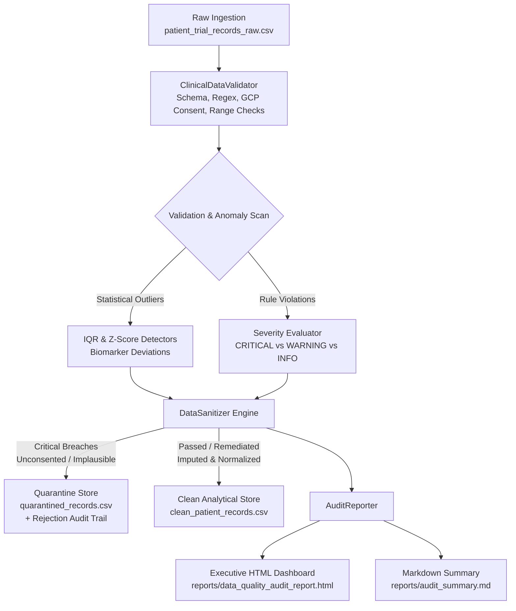

# 🏥 Automated Clinical Data Quality & Anomaly Detection Pipeline

[](https://www.python.org/)
[-brightgreen.svg)](https://pytest.org/)
[](LICENSE)
[](#architecture)

An enterprise-grade, audit-ready data validation, statistical anomaly detection, and automated remediation engine engineered for clinical trial registries, Real-World Data (RWD/RWE), and healthcare data platforms (such as Massive Bio, oncology data networks, and clinical analytics systems).

---

## 📑 Table of Contents
- [Executive Overview](#-executive-overview)
- [Architecture & Processing Workflow](#-architecture--processing-workflow)
- [Mathematical & Statistical Foundations](#-mathematical--statistical-foundations)
- [Severity Classification & Quarantine Protocol](#-severity-classification--quarantine-protocol)
- [Repository Structure](#-repository-structure)
- [Installation & Quickstart](#-installation--quickstart)
- [CLI Reference](#-cli-reference)
- [Automated Testing Suite](#-automated-testing-suite)
- [Audit Reports & Visualizations](#-audit-reports--visualizations)
- [Author & Professional Context](#-author--professional-context)

---

## 🎯 Executive Overview

In regulated clinical environments (GCP, HIPAA, FDA 21 CFR Part 11), real-world clinical datasets frequently arrive with heterogeneous schemas, inconsistent date formats, unconsented patient entries, transcription typos, and physiologically implausible laboratory values. 

Deploying predictive models or aggregating survival metrics over corrupted datasets introduces severe medical liability and regulatory rejection.

This engine solves this challenge by implementing a deterministic, zero-dependency validation and anomaly detection pipeline that:
1. **Enforces Strict Regulatory & Physiological Schemas:** Verifies patient consent compliance, primary key uniqueness, ISO 8601 timestamps, and biological limits (e.g. vital signs, tumor staging).
2. **Performs Multivariate Statistical Anomaly Detection:** Employs Tukey's Fences (Interquartile Range) and standardized Z-Score deviations to flag laboratory biomarker deviations (WBC, Hemoglobin, Platelets, Creatinine).
3. **Automates Quarantine & Remediation:** Isolates critical compliance failures into a dedicated quarantine store with detailed forensic logs, while safely imputing non-critical missing values using cancer-type stratified median imputation.
4. **Delivers Executive-Ready Audit Dashboards:** Automatically compiles self-contained interactive HTML dashboards and GitHub Markdown summaries tracking quality KPIs and data drift.

---

## 🏗 Architecture & Processing Workflow

The pipeline follows a modular, decoupled Clean Architecture:



---

## 📐 Mathematical & Statistical Foundations

### 1. Tukey's Fences (Interquartile Range Anomaly Detection)
For biomarker distributions that exhibit non-Gaussian or skewed characteristics (e.g., Creatinine, White Blood Cell counts), the pipeline computes empirical quartile bounds:

$$\text{IQR} = Q_3 - Q_1$$

$$\text{Lower Bound} = Q_1 - k \times \text{IQR}, \quad \text{Upper Bound} = Q_3 + k \times \text{IQR} \quad (k = 1.5)$$

Any observation $x_i < \text{Lower Bound}$ or $x_i > \text{Upper Bound}$ is flagged as a statistical outlier and cataloged for clinical review.

### 2. Standardized Z-Score Anomaly Detection
For biomarkers assuming approximately normal distributions across broad trial cohorts:

$$Z_i = \frac{x_i - \mu}{\sigma}$$

An anomaly is registered when:

$$|Z_i| \ge \tau \quad (\tau = 3.0)$$

*Zero-variance protection:* If standard deviation $\sigma = 0$ (e.g., small or constant cohorts), the detector gracefully defaults to zero anomaly attribution without zero-division exceptions.

### 3. Stratified Median Imputation
Rather than applying naive global mean imputation—which distorts biological variance across distinct cancer histologies—missing benign laboratory values are imputed via stratified median substitution conditioned on the patient's primary diagnosis:

$$\hat{x}_{i, k} = \text{median}\left(\{x_{j, k} \mid \text{Diagnosis}_j = \text{Diagnosis}_i \land x_{j, k} \text{ is not null}\}\right)$$

### 4. Overall Data Quality Score (DQS)
The system calculates an executive data health index weighted by defect severity:

$$\text{DQS} = \max\left(0, 100 \times \left(1 - \frac{\sum_{i} w_i \cdot v_i}{N_{\text{records}} \times N_{\text{fields}}}\right)\right)$$

Where $w_{\text{CRITICAL}} = 3.0$, $w_{\text{WARNING}} = 1.0$, and $w_{\text{INFO}} = 0.1$.

---

## 🚦 Severity Classification & Quarantine Protocol

| Severity | Target Domain | Trigger Conditions | Pipeline Action |
|:---|:---|:---|:---|
| **`CRITICAL`** | Regulatory & Biological | - Missing GCP trial consent (`has_trial_consent == False`)<br>- Corrupted/Malformed Patient ID (Regex: `^PAT-[A-Z0-9]{8}$`)<br>- Duplicate primary key instances<br>- Biological impossibility (e.g. `Age < 18`, `WBC > 100`, `Platelets <= 0`) | **Quarantined**: Excluded from analytical clean data; serialized to `data/processed/quarantined_records.csv` with granular failure reasons. |
| **`WARNING`** | Statistical & Clinical | - Statistical outliers via Tukey's IQR or Z-score ($> 3\sigma$)<br>- Missing benign laboratory biomarker<br>- Borderline elevated creatinine / bilirubin | **Retained & Remediated**: Stratified median imputation applied; anomaly logged in quality audit trail. |
| **`INFO`** | Format & Conventions | - Non-canonical gender casing (`female`, `M`, `f`)<br>- Inconsistent date formatting | **Normalized**: Standardized to canonical title casing and ISO 8601 (`YYYY-MM-DD`). |

---

## 📁 Repository Structure

```
clinical-data-quality-pipeline/
│
├── data/
│   ├── raw/
│   │   └── patient_trial_records_raw.csv     # 1,000 synthetic cohort records with realistic defects
│   └── processed/
│       ├── clean_patient_records.csv         # Approved, standardized, analytics-ready records
│       └── quarantined_records.csv           # Isolated non-compliant records with rejection logs
│
├── reports/
│   ├── data_quality_audit_report.html        # Interactive, self-contained executive HTML dashboard
│   └── audit_summary.md                      # GitHub-native markdown executive summary
│
├── src/
│   ├── __init__.py                           # Module export definitions
│   ├── schema.py                             # Declarative constraints, biological bounds & field definitions
│   ├── anomaly.py                            # Tukey's IQR & Z-Score statistical anomaly detectors
│   ├── validator.py                          # Multi-phase validation engine & issue aggregation
│   ├── cleaner.py                            # Sanitizer, stratified imputer & quarantine router
│   ├── generator.py                          # Controlled synthetic clinical cohort dataset generator
│   └── reporter.py                           # Executive HTML and Markdown report compilation engine
│
├── tests/
│   ├── __init__.py
│   ├── test_schema.py                        # Tests for schema metadata, constraints & bounds
│   ├── test_anomaly.py                       # Unit tests for IQR & Z-score detectors & edge cases
│   ├── test_validator.py                     # Tests for consent, duplicate IDs & biological limits
│   └── test_cleaner.py                       # Tests for normalization, imputation & quarantine isolation
│
├── .gitignore                                # Comprehensive Python/IDE ignore file
├── main.py                                   # Professional CLI entrypoint
├── requirements.txt                          # Pinned dependency manifest
└── README.md                                 # Technical documentation
```

---

## ⚡ Installation & Quickstart

### Prerequisites
- Python 3.10+ (tested on Python 3.10, 3.11, 3.12, 3.14)
- `uv` (recommended) or standard `pip`

### 1. Clone & Set Up Environment

```bash
# Clone the repository
git clone https://github.com/sefakesen/clinical-data-quality-pipeline.git
cd clinical-data-quality-pipeline

# Create virtual environment
python -m venv .venv

# Activate virtual environment
# Windows (PowerShell):
.\.venv\Scripts\Activate.ps1
# Linux/macOS:
source .venv/bin/activate

# Install required dependencies
pip install -r requirements.txt
```

*(Alternatively, using `uv`: `uv venv && uv pip install -r requirements.txt`)*

### 2. Execute the Pipeline

Generate a fresh 1,000-record cohort with controlled defects, validate, remediate, and generate audit reports in a single command:

```bash
python main.py --generate
```

---

## 💻 CLI Reference

`main.py` provides an intuitive command-line interface:

```bash
# Generate 1,000 synthetic clinical records and run full audit pipeline
python main.py --generate

# Customize synthetic cohort sample size
python main.py --generate --records 2500

# Execute pipeline against an existing dataset without regenerating data
python main.py --input-file data/raw/patient_trial_records_raw.csv

# Audit-only mode (validates without generating clean/quarantined CSV output)
python main.py --audit-only

# Disable report generation for headless/batch environments
python main.py --no-report
```

---

## 🧪 Automated Testing Suite

All validation rules, statistical anomaly boundaries, normalization routines, and quarantine algorithms are validated with comprehensive unit tests using `pytest`.

Run the test suite:

```bash
pytest -v
```

### Test Coverage Highlights:
- `test_iqr_detector_with_known_outliers`: Verifies exact mathematical detection of injected upper/lower extreme values.
- `test_zscore_zero_variance`: Validates zero-division defensive handling for invariant distributions.
- `test_validator_detects_unconsented_records`: Ensures unconsented records trigger `CRITICAL` severity flags.
- `test_validator_detects_duplicate_patient_ids`: Enforces primary key uniqueness across trial records.
- `test_validator_detects_physiological_violations`: Confirms out-of-boundary biological metrics are flagged.
- `test_cleaner_imputes_benign_missing_labs`: Validates group-wise median imputation on missing laboratory values.
- `test_cleaner_quarantines_critical_failures`: Asserts that critical breaches are quarantined with full reason traceability.

---

## 📊 Audit Reports & Visualizations

Upon pipeline completion, the engine produces two audit artifacts in the `reports/` directory:

### 1. Interactive HTML Dashboard (`reports/data_quality_audit_report.html`)
- **Executive Metric Cards:** Total Ingested Records, Overall Quality Score (%), Clean Approved Records, Quarantined Records, Statistical Warnings.
- **Quarantine Reason Breakdown:** Visual breakdown of primary failure modes (GCP unconsented entries, malformed IDs, duplicate IDs, physiological limit breaches).
- **Statistical Biomarker Anomaly Table:** Granular comparison between IQR and Z-Score outlier counts, outlier percentages, and dynamic empirical threshold intervals.
- **Self-Contained Styling:** Embedded modern CSS dashboard with responsive layout, status badges, and typography.

### 2. Markdown Executive Summary (`reports/audit_summary.md`)
- Ready for automated CI/CD pipeline integration, pull request comments, or executive GitHub summaries.

### Sample Pipeline Benchmark:
```text
======================================================================
[*] CLINICAL DATA QUALITY & ANOMALY DETECTION ENGINE
======================================================================

[1/4] Generating 1,000 synthetic clinical records with controlled defects...
      [OK] Raw dataset saved to: data/raw/patient_trial_records_raw.csv

[2/4] Executing comprehensive quality validation suite...
      [OK] Total Records Evaluated : 1,000
      [OK] Overall Quality Score   : 97.47%
      [OK] Critical Violations     : 68
      [OK] Statistical Warnings    : 166

[3/4] Running automated sanitization, imputation & quarantine isolation...
      [OK] Clean Records Approved  : 934 saved to clean_patient_records.csv
      [OK] Quarantined Records     : 66 saved to quarantined_records.csv
      [OK] Imputed Fields          : 75
      [OK] Normalized Fields       : 30

[4/4] Compiling executive audit reports...
      [OK] Interactive HTML Dashboard : reports/data_quality_audit_report.html
      [OK] Markdown Summary           : reports/audit_summary.md

======================================================================
[SUCCESS] PIPELINE EXECUTION COMPLETED SUCCESSFULLY
======================================================================
```

---

## 👨‍💻 Author & Professional Context

Developed by **Sefa Kesen** as part of an enterprise-grade portfolio demonstrating production data engineering and clinical data analytics capabilities.

- **LinkedIn:** [linkedin.com/in/sefakesen](https://www.linkedin.com/in/sefakesen)
- **GitHub:** [github.com/sefakesen](https://github.com/sefakesen)
- **Portfolio Focus:** Clean Architecture, Statistical Quality Control, Clinical & Real-World Healthcare Data Analytics (RWD/RWE), Automated Data Pipelines.

---

## 📄 License
This project is licensed under the MIT License - see the [LICENSE](LICENSE) file for details.
